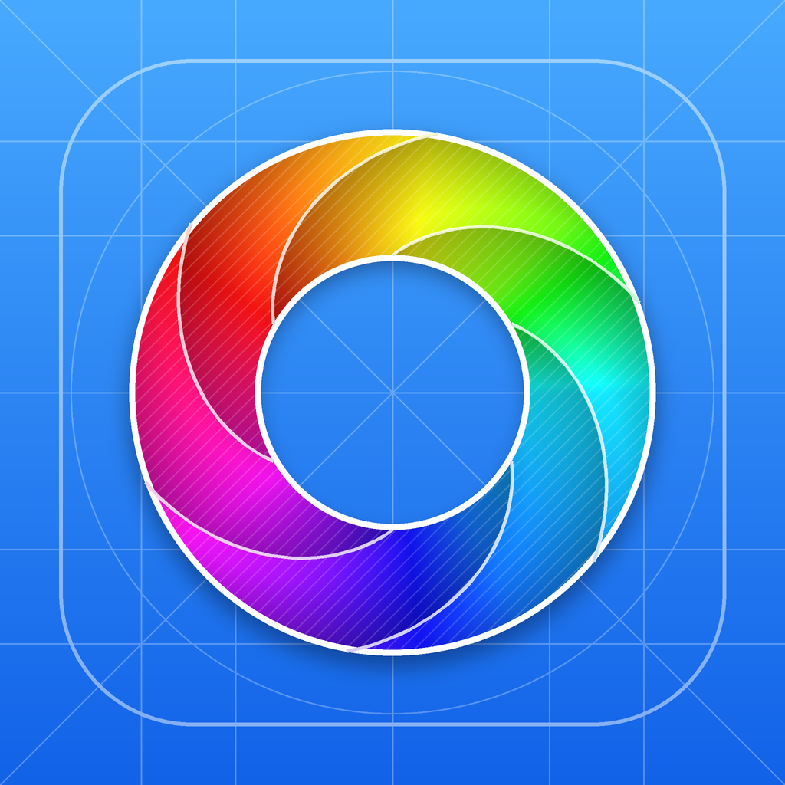

<p align="center">
  
</p>

<h1 align="center">Changelog</h1>

<p align="center">
  Everything that changed in <b>Developer Tools for Homey</b>, newest first.
</p>

<p align="center">
  
  
  
  
</p>

<p align="center">
  <a href="README.md">README</a> ·
  <a href="https://github.com/LRvdLinden/Athom-Homey-dev-ios/releases">Releases</a> ·
  <a href="https://github.com/LRvdLinden/Athom-Homey-dev-ios/issues">Report an issue</a>
</p>

---

### At a glance

| Version | Highlights | Platforms |
|:--|:--|:--|
| [**1.3.7**](#137) | Apple TV removed, notification fixes, faster loading, full translations | 📱 iPhone · 📱 iPad · ⌚️ Apple Watch |
| [1.3.6](#136) | Real Homey product images | 📱 iPhone · 📱 iPad |
| [1.3.5](#135) | Apple Watch app with complications, test push | 📱 iPhone · 📱 iPad · 📺 Apple TV · ⌚️ Apple Watch |
| [1.3.4](#134) | Push check every 30 minutes | 📱 iPhone · 📱 iPad · 📺 Apple TV |
| [1.3.3](#133) | Privacy, disclaimer, version and copyright on the Account page | 📱 iPhone · 📱 iPad · 📺 Apple TV |
| [1.3.2](#132) | Direct push notifications through OneSignal | 📱 iPhone · 📱 iPad |
| [1.3.1](#131) | Status notifications for every build change | 📱 iPhone · 📱 iPad |
| [1.3.0](#130) | Apple TV pairing over Wi-Fi, Siri Remote scrolling, Mac version removed | 📱 iPhone · 📱 iPad · 📺 Apple TV |
| [1.2.9](#129) | Apple TV sign-in without iCloud, Mac sign-in crash fix | 📱 · 📺 · 💻 |
| [1.2.8](#128) | Mac app (Mac Catalyst) | 📱 · 📺 · 💻 |
| [1.2.7](#127) | Apple TV app | 📱 · 📺 |
| [1.2.6](#126) | Native Homey tools in the app | 📱 |
| [1.2.5](#125) | iPad support, richer widgets | 📱 |
| [1.2.4](#124) | Home screen widgets | 📱 |
| [1.2.3](#123) | Developer actions and member management | 📱 |
| [1.2.1](#121) | Installs-per-app chart redesign | 📱 |
| [1.2.0](#120) | Dutch, English, German and French | 📱 |
| [1.1.0](#110) | New icon, blueprint login, spinning splash | 📱 |
| [1.0.0](#100) | First release | 📱 |

> **Legend:** ✨ New · 🛠 Fixed · 🔄 Changed · 🗑 Removed

---

## 1.3.7

 

- 🗑 **Apple TV support removed.** The tvOS app, Wi-Fi pairing and iCloud Keychain sharing are gone, along with the local-network permission. The iCloud Keychain item older versions shared is cleaned up once.
- 🛠 **Notifications no longer go silent when the push server stops.** Status notifications and *Direct via push* now work side by side. They share one notification ID, so the same change never shows up twice. With push alone on, the app warns that nothing arrives if the GitHub job isn't running.
- 🛠 A partly failed refresh (one organization not loading) no longer wipes the remembered status of those apps, so their next change is still noticed. The push job keeps that status too.
- 🛠 The Personal Access Token for background checks is now verified before it's stored, retried once, and gives a clear message when it can't be fetched.
- 🔄 **Fewer OneSignal tags:** one tag per account, plus a tag only for the status kinds you turned off. Old tags are removed automatically.
- 🔄 The status-push workflow now keeps only the newest status cache instead of adding one every run.
- ⚡️ **Faster loading:** own apps, organizations and organization apps load in parallel, in the app and in the background check.
- ⚡️ Widget statistics (install history, suggestions, devices) are fetched at most once an hour; in between only install counts update. That's about 36 fewer requests per refresh.
- ⚡️ One Homey session per Homey, shared by every screen, so screens open faster.
- ⌚️ The Apple Watch gets a smaller summary (30 days, top apps), so it stays within the WatchConnectivity size limit.
- 🌍 **Full translations:** every missing English, German and French string is added, including privacy, disclaimer and notifications. The Apple Watch app and its complications are now translated too.
- 🧹 The native Homey tools are split into one file per tool. The Android skeleton is removed from the repository.

## 1.3.6


- 🎨 **Homeys** now show the real product image of each Homey, the same ones my.homey.app uses: the black Homey Pro, the Homey Cloud house, the Self-Hosted Server box and so on, in light and dark mode (`modelImage` from the Athom API).
- 🔄 Model names follow my.homey.app, e.g. *Homey Pro (Early 2023)*, *Homey Pro mini*, *Homey Self-Hosted Server*.
- 🎨 The images also appear on the Homey detail page and in the header of the native tools.

---

## 1.3.5


#### ⌚️ Apple Watch app (watchOS 10+)
- ✨ Comes with the iPhone app; no login on the watch. The iPhone sends the same summary the widgets use (WatchConnectivity) after every refresh.
- ✨ **Overview:** total installs, 7-day change, 30-day trend, Cloud/Local, in review and live crashes.
- ✨ **My Apps:** installs and growth per app, with a detail page (versions, test status, devices, rating, crashes, trend).
- ✨ **Attention:** apps in review and apps with crashes.
- ✨ **Complications:** circular, corner, inline and rectangular, with installs, 7-day change and apps in review.

#### 🔔 Push notifications
- ✨ **Test push:** *Actions → Status push → Run workflow* now has a *Send a test push to every account* option. It uses exactly the same targeting as real status pushes, so you can check the whole chain.
- 🛠 The workflow log shows the status of every app, the number of changes and why a push didn't reach a device.
- 🛠 The app re-sends its push tags to OneSignal at every launch.

---

## 1.3.4


- 🔄 **Direct push:** the GitHub Actions job now checks every **30 minutes** instead of every 10. That keeps it within the 2,000 free Actions minutes per month of a private repository (about 1,450 minutes).
- 🔄 The notification settings and the README say "every half hour".
- 🎨 The Privacy & terms and Disclaimer rows on the Account page now use the same plain blue icons as the other rows (iPhone, iPad and Apple TV).
- 📦 iPhone, iPad and Apple TV are all on 1.3.4 (19).

---

## 1.3.3


**About the app**, at the bottom of the Account page on iPhone, iPad and Apple TV.

- ✨ **Privacy & terms**: what the app stores (only on your device), who it talks to (Athom only), no tracking, how notifications, OneSignal, Apple TV pairing and widgets work, and how to remove your data.
- ✨ **Disclaimer**: unofficial app, not affiliated with Athom; actions in the app are real; data without warranty.
- ✨ Footer with the version and build number and **© HomeyDev - PixelForges**.
- 🎨 Settings-style icon tiles and card layout, matching the rest of the app. On the Apple TV the pages scroll with the Siri Remote.

---

## 1.3.2

 

**⚡️ Direct push notifications.** Status changes now arrive as real push notifications, also when the app is closed.

```
GitHub Actions (every 10 min) ──► Athom Apps API ──► status changed? ──► OneSignal ──► 📱
```

- ✨ New toggle **Account → Notifications → Direct via push (OneSignal)**.
- ✨ A scheduled GitHub Actions job (`.github/workflows/status-push.yml`) checks all your apps every 10 minutes and sends a push for: 📦 draft · 🧪 Test · ⏳ in review · ✅ approved · ⛔️ rejected · 📡 Live.
- ✨ Your per-status choices are respected: the device is tagged per status, and the job only targets devices that want that status.
- ✨ Multiple accounts: each device is tagged per Athom account.
- 🔄 With push on, the on-device checks from 1.3.1 no longer show their own notifications, so you never get the same one twice.
- 🔒 The OneSignal REST API key and your Personal Access Tokens live only in GitHub Actions secrets, never in the app or the repository.

---

## 1.3.1


**🔔 Status notifications.** Get a notification whenever a build of one of your apps changes status.

| Notification | When |
|:--|:--|
| 📦 **New build (draft)** | A new build was uploaded |
| 🧪 **In Test** | A build was published to Test |
| ⏳ **Submitted for certification** | A build is in review |
| ✅ **Approved** | Athom approved the build |
| ⛔️ **Rejected** | Athom rejected the build |
| 📡 **Live** | A build was published to Live |

- ✨ Turn them on under **Account → Notifications**, and choose per status which ones you want. A **Send test notification** button shows what they look like.
- ✨ Works for all your accounts and organizations; with several accounts the account name is shown in the notification.
- ✨ Checks run on every refresh and in the background (Background App Refresh). iOS decides how often, usually every 15 minutes to a few hours.
- ℹ️ These are local notifications: the app checks the status itself, so no server is involved. Background checks use each account's Personal Access Token, stored in the iOS Keychain.

---

## 1.3.0


**iPhone, iPad and Apple TV, focused.** This release brings together all the Apple TV work from 1.2.9 and drops the Mac version.

#### 📺 Apple TV
- ✨ **Pair over Wi-Fi.** The Apple TV shows a 4-digit code. On your iPhone, open **Account → Apple TV → Pair over Wi-Fi**, pick the TV and enter the code. Accounts are sent encrypted over your own network, without iCloud.
- ✨ **Sign in with a Personal Access Token** directly on the TV. Your iPhone offers its keyboard so you can paste it.
- ✨ Accounts added on the Apple TV can be removed there: press and hold an account under **Account**.
- 🛠 The dashboard and app detail now scroll with the Siri Remote.
- 🛠 The **Menu** button goes back from an app to the list.
- 🛠 Opening an app from an organization no longer jumps straight back.
- 🔄 iCloud Keychain sharing still works and now shows an error when saving fails. The TV keeps checking for new accounts.
- 🗑 The **Homeys** tab is gone from the Apple TV.

#### 📱 iPhone & iPad
- 🛠 Signing in and switching accounts close the login screen first, then switch, so the app never rebuilds behind an open sheet.
- 🛠 The iPad sidebar keeps one navigation stack.
- 🔄 iPhone, iPad and Apple TV share one bundle ID: one App Store app with universal purchase.

#### 🗑 Removed
- The Mac (Mac Catalyst) version, its entitlements and its icon sizes.

---

## 1.2.9


- ✨ **Apple TV:** pair over Wi-Fi or enter a Personal Access Token, so sign-in no longer depends on iCloud Keychain.
- 🛠 **Apple TV:** scrolling with the Siri Remote, back navigation and opening apps from organizations.
- 🗑 **Apple TV:** Homeys tab removed.
- 🛠 **Mac:** fixed a crash when signing in or adding an account.
- 🛠 **Build:** fixed several "unable to type-check this expression in reasonable time" errors in the native Homey tools.
- 🔄 All platforms share one bundle ID.

---

## 1.2.8

- ✨ **Mac app** (Mac Catalyst, macOS 14+): Developer Tools-style sidebar, all features including email/password sign-in, native Homey tools, right-click menus, **⌘R** to refresh, Help menu links, a macOS-style icon and widgets on the desktop.
- ✨ README with illustrative screenshots of every platform.

---

## 1.2.7

- ✨ **Apple TV app** (tvOS 17+): a full-screen dashboard with installs, Cloud/Local, review, crashes, rating, a 60-day trend and top apps, refreshing every 5 minutes.
- ✨ Read-only **My Apps**, **Organizations**, **Homeys** (devices and Insights) and account switching on the TV.
- ✨ Accounts shared from the iPhone through iCloud Keychain, using each account's Personal Access Token.
- ✨ Layered parallax tvOS icon and Top Shelf images.

---

## 1.2.6

**The Developer Tools *Tools* now run natively in the app** through the Homey Web API:

| Tool | What you can do |
|:--|:--|
| 🖥 **System** | Info, memory, storage, rename, reboot, updates, experiments |
| 📈 **Insights** | Logs with charts |
| 🕸 **Zigbee** | Network, devices with LQI, update nodes |
| 📡 **Z-Wave** | Controller, stats, nodes: test frame, heal, re-interview, remove failed |
| 🔵 **Bluetooth LE** | Peripherals with RSSI |
| 📻 **RF** | 433/868 MHz record, replay, emulate |
| 🔴 **Infrared** | Send Pronto hex |
| 🖼 **Images** · 🎬 **Videos** | Browse and view |

Only Pairing still opens the website. The tools are also in the iPad sidebar.

---

## 1.2.5

- ✨ **iPad support:** a Developer Tools-style sidebar with all sections and the Homey tools; grids adapt to the width.
- ✨ **Fuller widgets** using real install history from Athom install stats, drawn as a Homey Insights-style chart.
- ✨ The **Installs** widget can show one app (long-press → *Edit Widget*). The small size shows your top app by default, with name and icon.
- ✨ New stats: 30-day change, paired devices, suggestions, crashes per app and fastest growers.
- ✨ Large sizes for **Installs** and **Review & crashes**.

---

## 1.2.4

- ✨ Three home screen widgets: **Installs** (small, medium), **Top apps** (medium, large) and **Review & crashes** (small, medium).
- 🗑 The automated review screen.

---

## 1.2.3

**Developer actions**, using the same API calls as Developer Tools.

- ✨ **Builds:** *Publish to Test*, *Submit for Certification* (with auto-release), *Retract submission* and *Publish to Live*, plus the reviewer comment thread and the automated review.
- ✨ **Home:** a one-tap *Retract* button for apps in review.
- ✨ **Apps:** reply to user reviews, email notification settings, transfer to an organization.
- ✨ **Organizations:** member profile pictures, invite members, change roles (Admin / Developer / Support), remove members and rename the organization.

---

## 1.2.1

- 🛠 Redesigned **Installs per app** chart on Home: app names and totals sit above each bar, so bars no longer overlap the labels.
- ✨ Rows are tappable and show the Cloud/Local split.

---

## 1.2.0

- ✨ **Multilingual:** 🇳🇱 Dutch, 🇬🇧 English, 🇩🇪 German and 🇫🇷 French, following the device language.
- ✨ A language row under **Account → Appearance**.

---

## 1.1.0

- ✨ New Apple Developer-style app icon with a white Homey ring.
- ✨ Blue blueprint login screen.
- ✨ Spinning Homey logo on the splash screen.

---

## 1.0.0

- ✨ **First release.** Sign in with Homey or a Personal Access Token, multiple accounts, and the **Home**, **My Apps**, **Organizations**, **Homeys** and **Account** tabs.

---

<p align="center">
  <sub>Unofficial app. Homey and the Homey logo are trademarks of Athom B.V.</sub>
</p>
