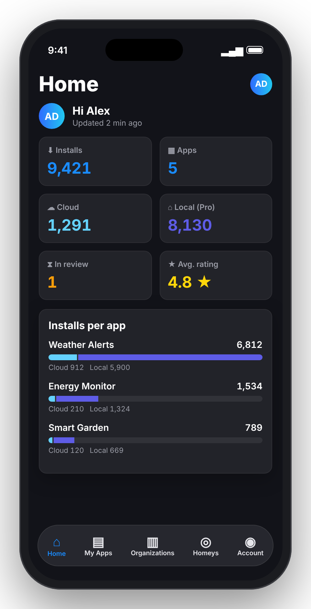
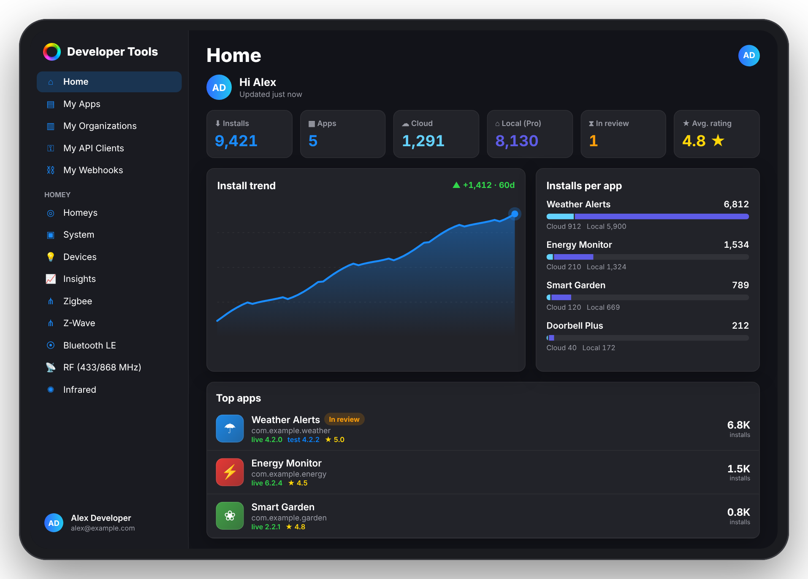
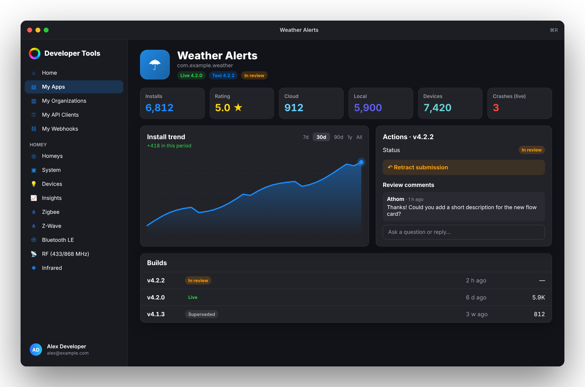
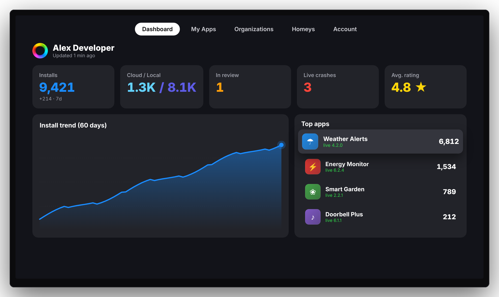
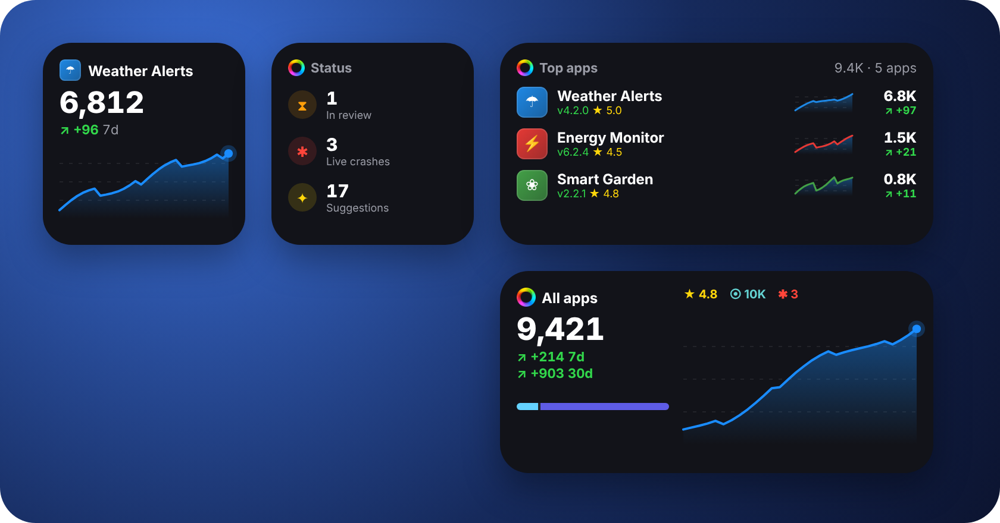

<p align="center"></p>

# Developer Tools for Homey – iOS

A native SwiftUI app for iPhone, iPad, Mac and Apple TV (iOS/iPadOS 17+, macOS 14+, tvOS 17+) that brings [Homey Developer Tools](https://tools.developer.homey.app) to your pocket. It supports multiple accounts, light and dark mode, and four languages.

> Unofficial app. Homey and the Homey logo are trademarks of Athom B.V.

## Screenshots

> Illustrative mockups with fictional data. The real app shows your own account, apps and Homeys.

<table>
  <tr>
    <th>iPhone (iOS)</th>
    <th>iPad (iPadOS)</th>
  </tr>
  <tr>
    <td align="center" valign="top"></td>
    <td align="center" valign="top"></td>
  </tr>
</table>

**Mac (macOS, Mac Catalyst)**: app detail with build actions (*Retract submission*) and the reviewer comment thread

<p align="center"></p>

**Apple TV (tvOS)**: full-screen dashboard that refreshes every 5 minutes

<p align="center"></p>

**Widgets**: Installs (small and medium), Top apps and Review & crashes

<p align="center"></p>

## Features

| Tab | What you get |
|---|---|
| **Home** | Totals across all your apps and organizations: installs, Cloud/Local split, apps in review and average rating. Also an installs-per-app chart, your top apps and apps awaiting certification. |
| **My Apps** | Your own apps with search and sorting. Per app: statistics, install trend (7d/30d/90d/1y/all), the live build with changelog and permissions, all builds, crashes with stack traces, suggestions, paired devices per driver and the raw API data. Build actions: publish to Test/Live, submit for certification and retract from review, plus the reviewer comment thread. Reply to reviews and manage email notifications. |
| **Organizations** | *My Organizations* from Developer Tools: apps, members with profile pictures and roles, and totals for each organization. Owners and admins can invite, re-role and remove members. |
| **Homeys** | The Homeys linked to your account. Control devices, trigger flows and advanced flows, restart apps and view their settings, and browse Logic variables, the timeline and system info. Includes a Web API Playground and native tools: System, Insights, Zigbee, Z-Wave, Bluetooth LE, RF, Infrared, Images and Videos. Pairing opens on the website. |
| **Account** | Switch, add and sign out of accounts, like in the Facebook app. Plus light/dark/automatic appearance, language, My API Clients, Webhooks, Personal Access Tokens, the API playgrounds and the full Developer Tools website. |

Also included:

- **Multilingual:** Dutch, English, German and French. The app follows your device language. You can pick a different language for this app only under **Settings → Homey Dev → Language**.
- **Splash screen** with a spinning Homey logo that continues seamlessly from the launch screen.
- **Design** inspired by Developer Tools and homey.app, with a blueprint-style app icon. Fully supports light and dark mode.

## Widgets

Add them from the home screen (long-press → **+** → *Homey Dev*):

| Widget | Sizes | Shows |
|---|---|---|
| **Installs** | Small, Medium, Large | One app (choose via *Edit Widget*) or all apps: installs, 7/30-day change, Homey Insights-style chart, Cloud/Local, rating, devices, suggestions, crashes and fastest growers |
| **Top apps** | Medium, Large | Your top 3 or 6 apps with icon, 30-day trend line, installs, 7-day change, version, rating, devices and review/crash markers |
| **Review & crashes** | Small, Medium, Large | Apps in review, crashes per app, suggestions and paired devices |

The app shares a snapshot with the widgets through the App Group `group.nl.lrvdlinden.homeydevtools`. The widgets don't need a login, and their data updates each time the app refreshes.

## Mac

The Mac app is built from the same code as the iPhone/iPad app (Mac Catalyst, *Optimize for Mac*):

- Choose **My Mac** as the run destination for the **HomeyDevTools** target.
- On the Mac the app uses its own sandbox entitlements (`HomeyDevTools-macOS.entitlements`) with network access, the App Group for the widgets and the shared keychain group.
- **⌘R** refreshes the data. The **Help** menu links to Developer Tools and the documentation. The widgets can be added to the Mac desktop (macOS 14+).

## Apple TV

1. In the iPhone app, go to **Account → Apple TV** and turn on **Share with Apple TV**. For each account, the app fetches its Personal Access Token (like *Reveal* in Developer Tools → My Account) and stores it in your iCloud Keychain.
2. Open **Homey Dev** on your Apple TV. It must use the same Apple Account. Your accounts appear automatically.

The TV app shows a dashboard that refreshes every 5 minutes, plus My Apps, Organizations, and Homeys with devices and Insights. It is read-only: there is no web view on tvOS, so sign-in and pairing happen on the iPhone.

## Signing in

**Sign in with Homey.** Use the email address and password of your Homey account, on Athom's own login page through Developer Tools. You don't need to set up an API client or secret.

- Each account signs in with its own isolated web session, so several accounts can be saved side by side.
- Sessions are stored in the iOS Keychain and refresh automatically, because Developer Tools refreshes its own token.

**Personal Access Token.** As an alternative, the same method used by the Developer Checker Homey app. Create a token in Developer Tools under *My Account*.

## Building

1. Open `HomeyDevTools.xcodeproj` in **Xcode 16 or later**.
2. Select your **Team** under *Signing & Capabilities* for all three targets: **HomeyDevTools**, **HomeyDevToolsWidget** and **HomeyDevToolsTV**. The bundle IDs are `nl.lrvdlinden.homeydevtools` (iPhone, iPad, Mac and Apple TV share it, so it is one App Store app with universal purchase) and `nl.lrvdlinden.homeydevtools.widgets`. Xcode registers the App Group automatically.
3. Choose an iPhone or simulator and press ▶︎.

There are no third-party dependencies: only SwiftUI, Charts, WebKit and CryptoKit.

## Architecture

```
HomeyDevTools/
├─ App/                    Entry point, splash, tabs, PortfolioStore, Config
├─ Core/                   Theme (light/dark), flexible JSON, HTTP, Keychain, JWT
├─ API/                    AuthManager (multi-account), WebSession, AppsAPI, HomeyClient
├─ Models/                 DevApp, DevBuild, DevCrash, DevOrganization, HomeyRef, HomeyDevice, …
├─ Views/                  Login, Dashboard, Apps, Organizations, Homey, Web, Account, Components
└─ Localizable.xcstrings   Translations (nl source, en, de, fr)
```

The app uses these endpoints:

- Account token → `POST api.athom.com/delegation/token?audience=apps` → `apps-api.athom.com/api/v1/…` for apps, organizations, builds, crashes and statistics.
- Account token → `delegation/token?audience=homey` → `POST <homey>/api/manager/users/login` → Homey Web API.
- `api.athom.com/user/me` for the profile and linked Homeys, and `/user/me/client` for API clients.

## Adding a language

Open `Localizable.xcstrings` in Xcode, click **+** to add a language and translate the strings. Then add the language code to `knownRegions` in the project.

## Changelog

- **1.2.8:** **macOS app** (Mac Catalyst, optimized for Mac, macOS 14 Sonoma+). It has the Developer Tools-style sidebar, all features including sign-in with email and password, native Homey tools, right-click menus, ⌘R to refresh, Help menu links, a macOS-style icon and the widgets on the Mac desktop.
- **1.2.7:** **Apple TV app (tvOS 17+)**: a full-screen dashboard (installs, Cloud/Local, review, crashes, rating, 60-day trend, top apps) that refreshes every 5 minutes, plus read-only My Apps, Organizations, Homeys (devices and Insights) and account switching. Accounts are shared from the iPhone through iCloud Keychain (*Account → Apple TV*), using each account's Personal Access Token. Includes a layered parallax tvOS icon and Top Shelf images.
- **1.2.6:** The Developer Tools *Tools* now run **natively in the app** through the Homey Web API: **System** (info, memory, storage, rename, reboot, updates, experiments), **Insights** (logs with charts), **Zigbee** (network, devices with LQI, update nodes), **Z-Wave** (controller, stats, nodes: test frame, heal, re-interview, remove failed), **Bluetooth LE** (peripherals with RSSI), **RF** (433/868 MHz record, replay, emulate), **Infrared** (send Pronto hex), **Images** and **Videos**. Only Pairing still opens the website. The tools are also in the iPad sidebar.
- **1.2.5:** **iPad support**: on iPad (and in wide Split View) the app shows a Developer Tools-style sidebar with all sections and the Homey tools, and grids adapt to the width. Fuller widgets. They now use real install history from Athom install stats (the same data as Developer Tools), drawn as a Homey Insights-style chart. The **Installs** widget can show one app (long-press → *Edit Widget*); the small size shows your top app by default, with name and icon. New stats: 30-day change, paired devices, suggestions, crashes per app and fastest growers. Large sizes added for **Installs** and **Review & crashes**.
- **1.2.4:** Three home screen widgets: **Installs** (small and medium), **Top apps** (medium and large) and **Review & crashes** (small and medium). The automated review screen was removed.
- **1.2.3:** Developer actions, using the same API calls as Developer Tools:
  - Builds: *Publish to Test*, *Submit for Certification* (with auto-release), *Retract submission* and *Publish to Live*, plus the reviewer comment thread and the automated review.
  - A one-tap *Retract* button for apps in review on Home.
  - Apps: reply to user reviews, email notification settings, transfer to an organization.
  - Organizations: profile pictures for members, invite members, change roles (Admin/Developer/Support), remove members and rename the organization.
- **1.2.1:** Redesigned *Installs per app* chart on Home: app names and totals sit above each bar, so bars no longer overlap the labels. Rows are tappable and show the Cloud/Local split.
- **1.2.0:** Multilingual app (Dutch, English, German, French) using a String Catalog, plus a language row under Account → Appearance.
- **1.1.0:** New Apple Developer-style app icon with a white Homey ring, a blue blueprint login screen and a spinning Homey logo on the splash screen.
- **1.0.0:** First release: sign in with Homey or a PAT, multiple accounts, Home, My Apps, Organizations, Homeys and Account.

## Feedback

Found a bug or a build error? Please open an [issue](https://github.com/LRvdLinden/Athom-Homey-dev-ios/issues).
